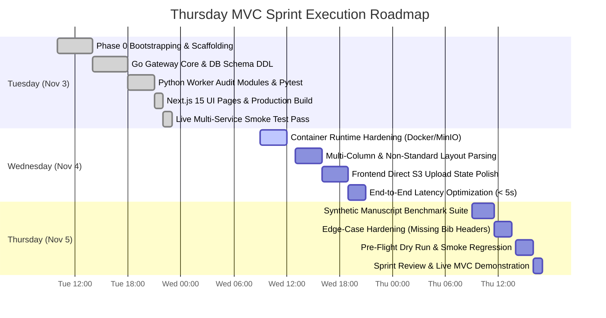

# Sprint 1 Task Planning: Breakdown & Drilldown (WBS)
## Journal Management System (JMS) with AI Pre-Submission Engine

**Sprint Target:** Thursday MVC Delivery (2026-11-05 at 17:00 WIB)  
**Total Velocity:** 26 Story Points (52 Ideal Engineering Hours)  
**Framework:** Decoupled Hexagonal / Clean Architecture (Go Gateway + Python 3.11 Worker + Next.js 15 Frontend)  

---

## 1. Work Breakdown Structure (WBS) Tree

```
WBS 1.0 JMS Pre-Submission Engine (MVC)
│
├── 1.1 Ingestion & Control Plane (Go API Gateway)
│   ├── 1.1.1 IAM, JWT & RBAC Middleware
│   ├── 1.1.2 S3 Presigned Direct Upload URL Generator
│   ├── 1.1.3 Transactional Metadata Submission Handler
│   └── 1.1.4 Audit Query & Reporting API
│
├── 1.2 Data Plane & Event Broker (Postgres + Redis)
│   ├── 1.2.1 PostgreSQL 16 Migration DDL (Enums, Tables, JSONB)
│   ├── 1.2.2 Redis LPUSH Publisher (`queue:ai_audit`)
│   └── 1.2.3 BRPOP Consumer Loop & Error Recovery
│
├── 1.3 AI Worker Parsing Engine (Python 3.11)
│   ├── 1.3.1 PyMuPDF Geometry & Margin Inspector (pt/mm)
│   ├── 1.3.2 spaCy NER & Regex Double-Blind Leak Detector
│   ├── 1.3.3 Bidirectional Citation Graph Cross-Checker
│   └── 1.3.4 Visual PDF Annotator (Red BBoxes & Sticky Notes)
│
├── 1.4 Frontend Control Plane (Next.js 15 App Router)
│   ├── 1.4.1 3-Step Manuscript Submission Wizard
│   ├── 1.4.2 Direct S3 Browser Upload Client
│   ├── 1.4.3 Real-Time Audit Inspection Dashboard
│   └── 1.4.4 Annotated PDF Download & Review Interface
│
└── 1.5 Quality Engineering & Demo Suite
    ├── 1.5.1 Unit Tests (Pytest 6/6 + Go Usecase Mocks)
    ├── 1.5.2 End-to-End Automated Integration Smoke Runner
    └── 1.5.3 Multi-Persona Demo Artifacts & Synthetic Papers
```

---

## 2. Granular Task Drilldown Matrix

### Epic 1: Ingestion & Control Plane (Go Gateway)

| Task ID | Task Title | Sub-Tasks & Implementation Drilldown | Effort | Dep | Verification & DoD |
|---|---|---|:---:|:---:|---|
| **TSK-101** | IAM & JWT Auth | Implement `auth_usecase.go`, password hashing with bcrypt, JWT token issuing (HS256, 72h expiry), and `RequireRoles` RBAC middleware. | 4h | None | Unit test authenticates `AUTHOR`, rejects tampered tokens with `401 Unauthorized`. |
| **TSK-102** | Presigned S3 Generator | Implement MinIO S3 SDK wrapper (`GeneratePresignedPutURL`) generating authenticated PUT URLs with 15-min expiry and MIME type constraints. | 3h | None | `curl -X PUT --upload-file` to presigned URL succeeds with `200 OK`. |
| **TSK-103** | Submission Transaction | Implement atomic GORM transaction writing `manuscript_files` (version tracking), updating manuscript state to `PRE_CHECK_PENDING`, and queuing audit record. | 4h | TSK-101 | SQL rollback on failure; atomic commit verified under concurrent submissions. |
| **TSK-104** | Audit Query API | Implement `GET /api/v1/audits/:id` fetching JSONB layout, anonymization, and citation issues, and mapped `annotated_pdf_s3_key`. | 2h | TSK-103 | Returns Step 4 strict JSON contract with `200 OK`. |

---

### Epic 2: Data Plane & Event Broker (Postgres + Redis)

| Task ID | Task Title | Sub-Tasks & Implementation Drilldown | Effort | Dep | Verification & DoD |
|---|---|---|:---:|:---:|---|
| **TSK-201** | Schema DDL & Seeds | DDL migrations for `users`, `manuscripts`, `manuscript_files`, `pre_submission_audits`. Add JSONB defaults and seed test personas (`author@jms.org`). | 3h | None | `psql -c "\dt"` displays 4 tables; seed data returns 4 users and 1 draft. |
| **TSK-202** | Redis Queue Publisher | Wire `EventPublisher` in Go gateway using `go-redis/v8` to `LPUSH` payload `{ audit_id, file_id, manuscript_id, s3_key, file_type }` to `queue:ai_audit`. | 2h | TSK-103 | Redis `RPOP` inspects valid JSON payload matching Go domain struct. |
| **TSK-203** | Worker Consumer Loop | Python `WorkerConsumer` listening via `BRPOP queue:ai_audit` with exponential backoff on connection failure and signal trapping for SIGINT/SIGTERM. | 3h | TSK-202 | Graceful shutdown terminates loop without message loss; re-queues on unhandled failure. |

---

### Epic 3: AI Pre-Submission Worker Engine (Python 3.11)

| Task ID | Task Title | Sub-Tasks & Implementation Drilldown | Effort | Dep | Verification & DoD |
|---|---|---|:---:|:---:|---|
| **TSK-301** | Margin & Layout Auditor | PyMuPDF text block extraction (`page.get_text("blocks")`). Coordinate math ($1\text{ mm} = 2.83465\text{ pt}$). Flag top, bottom, left, right breaches with `[x0, y0, x1, y1]`. | 5h | None | `test_layout.py` catches simulated top/bottom margin breaches with 100% precision. |
| **TSK-302** | Double-Blind Anonymizer | Integrate `spaCy` (`en_core_web_sm`) for `PERSON` and `ORG` recognition on title pages. Regex sweep for emails, ORCID (`\d{4}-\d{4}-\d{4}-\d{3}[\dX]`), and grants. | 5h | None | `test_anonymization.py` flags author email, ORCID ID, and PDF `/Author` metadata. |
| **TSK-303** | Citation Graph Crosscheck | Regex parser for numeric inline citations (`[1]`, `[1-3]`) and bibliography entries. Bidirectional difference analysis identifying missing citations and uncited references. | 4h | None | `test_citation.py` catches missing citation `[3]` and uncited bibliography `[2]`. |
| **TSK-304** | Visual PDF Redactor | PyMuPDF annotation engine. Draw dashed red rectangles (`fitz.Rect`) and sticky popups (`page.add_text_annot`) over all violation bounding boxes. Upload to S3. | 4h | TSK-301 | Output PDF opened in Acrobat/browser displays visible red highlight boxes and comments. |
| **TSK-305** | Persistence & Scoring | Calculate overall compliance score ($100 - (\text{critical} \times 15 + \text{warnings} \times 5)$), format Step 4 JSON contract, update PostgreSQL records. | 3h | TSK-304 | PostgreSQL `pre_submission_audits` updated to `COMPLETED` with score & JSON report. |

---

### Epic 4: Frontend Control Plane (Next.js 15 App Router)

| Task ID | Task Title | Sub-Tasks & Implementation Drilldown | Effort | Dep | Verification & DoD |
|---|---|---|:---:|:---:|---|
| **TSK-401** | Submission Wizard UI | 3-step reactive wizard: Step 1 (Title, Abstract, Keywords), Step 2 (Direct PDF Upload), Step 3 (AI Pre-Check trigger & redirect). | 4h | TSK-101 | Form validation blocks empty submissions; step state persists across transitions. |
| **TSK-402** | Direct S3 Upload Client | Browser `fetch` client executing HTTP PUT directly to presigned S3 URL with file MIME headers and progress reporting. | 3h | TSK-102 | Browser uploads 10MB test PDF without proxying through Next.js server. |
| **TSK-403** | Live Audit Dashboard | Interactive audit report page (`/submissions/[id]/audit`). Dynamic score meter, PASS/FAIL badge, and responsive check breakdowns. | 4h | TSK-104 | Auto-polls every 3 seconds until status is `COMPLETED`; renders cards dynamically. |
| **TSK-404** | PDF Viewer & Download | Embed downloadable link to MinIO S3 bucket for `annotated_v1.pdf`. Include direct visual inspection preview. | 2h | TSK-304 | Clicking download retrieves annotated PDF with verified visual bounding boxes. |

---

### Epic 5: Quality Assurance & Demo Harness

| Task ID | Task Title | Sub-Tasks & Implementation Drilldown | Effort | Dep | Verification & DoD |
|---|---|---|:---:|:---:|---|
| **TSK-501** | Integration Smoke Runner | Shell script (`scripts/test_audit_flow.sh`) generating synthetic test paper, authenticating, uploading, and polling until completion. | 3h | TSK-305 | Script runs unattended and exits with `0` in under 15 seconds. |
| **TSK-502** | Demo Presentation Package | Prepare 3 demo manuscripts (1 Clean Pass, 1 Layout Fail, 1 Anonymization Leak) for live demonstration during Thursday sprint review. | 2h | TSK-501 | Demo exhibits all 3 modules catching deliberate errors in under 3 minutes. |

---

## 3. Hourly Execution Roadmap to Thursday 17:00 WIB



---

## 4. Critical Path, Risk Registry & Mitigations

| Risk ID | Risk Description | Severity | Impact | Mitigation Strategy |
|---|---|:---:|---|---|
| **RSK-01** | S3 Presigned URL CORS in Browser | High | Direct upload blocked by browser `OPTIONS` pre-flight | MinIO configured with permissive CORS headers for `PUT` and `OPTIONS` origins `http://localhost:3000`. |
| **RSK-02** | spaCy Model Memory in Container | Medium | OOM kill during concurrent document processing | Pre-download `en_core_web_sm` during image build; reuse single singleton instance across worker loops. |
| **RSK-03** | Rotated / Scanned PDF Margins | Medium | Incorrect coordinate math on non-standard page rotations | Inspect `page.rotation` in PyMuPDF and apply transform matrix before computing millimeter margins. |
| **RSK-04** | Missing Bibliography Header | Low | Regex fails to split body from references | Fallback heuristic scanning for lines starting with `[1]` in the final 25% of document pages. |
