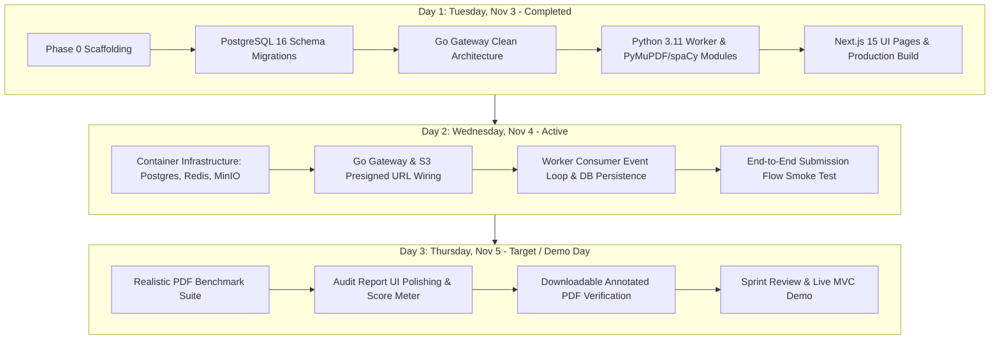

# Sprint Plan: Thursday MVC Delivery
## Journal Management System (JMS) with AI Pre-Submission Engine

**Sprint Cycle:** Sprint 1 (3-Day Fast Track)  
**Sprint Goal:** Deliver an end-to-end working Minimum Viable Candidate (MVC) demonstrating author manuscript submission, asynchronous AI parsing across 3 modules (layout, anonymization, citation), visual red-box PDF annotation, and an interactive Next.js 15 compliance report.  
**Target Delivery Date:** Thursday, 2026-11-05 (17:00 WIB)  
**Total Committed Story Points:** 26 SP  

---

## 1. Day-by-Day Sprint Cadence

---

## 2. Sprint Backlog & User Stories (MVC Scope)

### Story 1: Author Dual Direct S3 Ingestion Pipeline (5 SP)
* **As an** author or managing editor,
* **I want to** upload both the reference journal template and the author manuscript draft directly to object storage via presigned URLs,
* **So that** both files are safely stored without consuming API gateway memory, enabling comparative layout audit.
* **Acceptance Criteria:**
  - `POST /api/v1/manuscripts/:id/files/presign` returns valid S3 PUT URLs distinguishing `file_role: "TEMPLATE"` and `file_role: "MANUSCRIPT"`.
  - Client uploads binary streams directly to S3 with status `200 OK`.
  - `POST /api/v1/manuscripts/:id/files/confirm` creates both `manuscript_files` records (`MANUSCRIPT` and `TEMPLATE`), links `template_file_id` on `pre_submission_audits` in state `QUEUED`, and updates status to `PRE_CHECK_PENDING`.
* **Status:** Implemented & Verified across Go Gateway and S3 MinIO.

### Story 2: Asynchronous Redis Event Broker & Choreography (3 SP)
* **As a** system architect,
* **I want to** decouple submission HTTP requests from heavy AI processing via Redis,
* **So that** the gateway can handle concurrent submission traffic without timeouts.
* **Acceptance Criteria:**
  - Gateway pushes `{ audit_id, file_id, template_file_id, manuscript_id, s3_key, template_s3_key, file_type }` to Redis list `queue:ai_audit`.
  - Worker process consumes messages via `BRPOP` with error handling and exponential backoff.
* **Status:** Implemented in `backend/gateway/internal/infrastructure/redis` and `backend/ai-worker/app/worker.py`.

### Story 3: Multi-Module AI Manuscript Audit Engine with Template Comparison (8 SP)
* **As a** managing editor,
* **I want** the AI engine to extract layout guidelines from the uploaded template and audit the author's draft against them,
* **So that** desk review triage is automated with millimeter-level accuracy and strict double-blind standards.
* **Acceptance Criteria:**
  - Extracts target page format, dimensions, margins, and 1-column vs 2-column layout from reference template.
  - Geometry auditor flags breaches with expected template value vs actual draft measurement and bounding box coordinates.
  - spaCy NER detects names/emails/ORCIDs; citation engine cross-checks text citations against bibliography items.
* **Status:** Implemented in `app/modules/template.py`, `app/modules/layout.py`, `anonymization.py`, `citation.py`.
* **As an** editor and author,
* **I want** the system to automatically inspect page margins, double-blind anonymization, and citation graphs,
* **So that** formatting violations and identity leaks are caught before human review.
* **Acceptance Criteria:**
  - **Module 1 (Layout):** Measures top, bottom, left, right margins in points ($1\text{ mm} \approx 2.83465\text{ pt}$) against 25.4mm standard. Captures violation bounding boxes `[x0, y0, x1, y1]`.
  - **Module 2 (Anonymization):** Uses `spaCy` NER (`PERSON`, `ORG`) and regex to detect author names, affiliations, emails, ORCIDs, and PDF metadata.
  - **Module 3 (Citations):** Cross-checks inline citations `[n]` against bibliography entries. Flags `missing_citations` and `uncited_references`.
* **Status:** Implemented with 6/6 unit tests passing (`backend/ai-worker/tests/`).

### Story 4: Visual PDF Annotation Engine (5 SP)
* **As an** author,
* **I want to** view red bounding boxes and sticky notes over every formatting violation directly on my PDF,
* **So that** I know exactly where to make corrections.
* **Acceptance Criteria:**
  - PyMuPDF draws red rectangles `(1, 0, 0)` with width 1.5 pt over violation bounding boxes.
  - Injects sticky note annotations containing rule name and explanation.
  - Uploads `audits/annotated_{audit_id}.pdf` back to S3.
* **Status:** Implemented in `backend/ai-worker/app/modules/annotator.py`.

### Story 5: Interactive Next.js 15 Audit Report Viewer (5 SP)
* **As an** author or editor,
* **I want** a responsive web dashboard showing compliance score (0–100) and detailed checks,
* **So that** I can review the findings and download the annotated PDF.
* **Acceptance Criteria:**
  - Route `/submissions/[id]/audit?audit_id=...` renders score badge and PASS/FAIL status.
  - Renders tables of margin breaches with coordinates, detected anonymization leaks, and citation mismatches.
  - Includes a direct "Download Annotated PDF" button.
* **Status:** Implemented in Next.js 15 App Router; production build verified.

---

## 3. Definition of Done (DoD) for Thursday MVC

1. **Unit Test Coverage:** All core auditing algorithms pass deterministic unit tests.
2. **Clean Code & Decoupling:** Backend (Go Gateway + Python Worker) and Frontend (Next.js 15) remain strictly decoupled.
3. **Smoke Test Passing:** Synthetic manuscript run triggers Redis event, generates JSON report, and creates annotated PDF in under 15 seconds.
4. **Zero-Error Build:** Go binary compiles without warnings, Next.js passes `next build` static export check.

