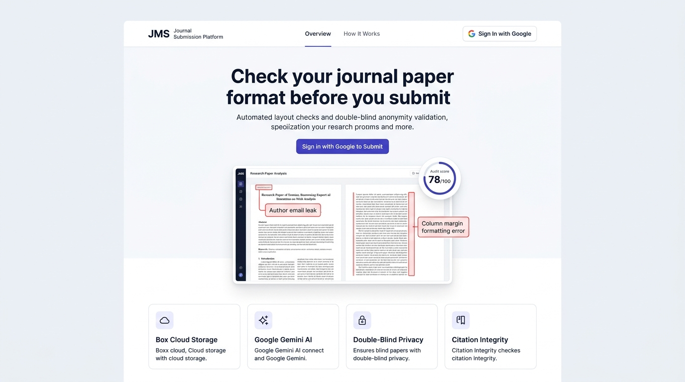
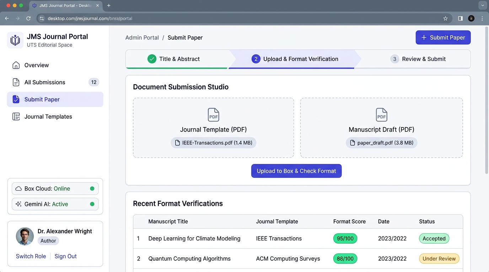

# Team Sprint Plan: Light-Mode UI Revamp & Admin Panel Sidebar Redesign

This document outlines the tasks, visual mockups, and implementation guide for our upcoming sprint. It is written for the entire team so we can divide and conquer the work on GitHub.

---

## 🎯 Sprint Goal

1. **Light Mode Only:** Remove all dark mode backgrounds and text. Switch the entire application to a clean, crisp, academic light mode (clean white cards, light slate backgrounds, and dark high-contrast text).
2. **Proper Authentication Flow:** Never show "Go to Portal" or dashboard links to visitors before they log in. Visitors only see public information and a "Sign in with Google" button.
3. **Dedicated Admin Sidebar Layout:** Replace the single top navbar in the admin panel with a standard SaaS **Left Sidebar (260px wide)** containing navigation links, user profile, role switcher, and sign-out controls.

---

## 🎨 Visual Mockup Gallery (What It Must Look Like)

### 1. Screen 1: Public Landing Page (`/`)

> **Design Goal:** Clean, modern academic SaaS landing page in pure light mode. Visitors can read the features and see a visual demo of how the pre-check engine highlights layout flaws. Visitors must click **"Sign In with Google"** to open the submission portal.



#### Key UI Specifications for Developers:
* **Background:** `#f8fafc` (Tailwind `bg-slate-50`)
* **Cards:** `#ffffff` (Tailwind `bg-white`) with subtle border `#e2e8f0` (`border-slate-200`) and soft shadow (`shadow-sm`).
* **Top Navbar (Height 64px):**
  - Left: Indigo square logo with "JMS", Title: "Journal Submission Platform", Badge: "UTS Edition".
  - Center: Navigation links ("Overview", "How It Works").
  - Right: Indigo button **"Sign In with Google"** (triggers Google SSO modal).
* **Centerpiece Sample Review Card:**
  - 3-column split view comparing target journal specs (left) with an author draft PDF (middle).
  - Red dashed boxes highlight the **Double-Blind Email Leak** and **Single-Column Mismatch**.
  - Right column shows the **Scorecard: 78/100** with checklist items.

---

### 2. Screen 2: Admin Workspace & In-Admin Submission Studio (`/admin`)

> **Design Goal:** Professional SaaS dashboard with a fixed Left Sidebar (260px wide). Authors and editors manage submissions and upload their papers directly inside this protected workspace.



#### Key UI Specifications for Developers:
* **Left Sidebar (Width: 260px, fixed, sticky, `bg-white border-r border-slate-200`):**
  - **Top:** JMS brand logo and "Journal Portal (UTS Editorial Space)".
  - **Navigation Links:**
    - 📊 **Overview** (`activeTab === 'overview'`)
    - 📄 **All Submissions** (`activeTab === 'submissions'`) with submission count badge
    - ➕ **Submit Paper** (`activeTab === 'new-submission'`) with active indigo highlight
    - 📚 **Journal Templates** (`activeTab === 'templates'`)
  - **System Telemetry:** Status strip showing *Box Cloud: Online* and *Gemini AI: Active*.
  - **Bottom Profile Card:** User avatar, name (`Dr. Alexander Wright`), role badge (`Author`), **"Switch to Editor View"** button, and **"Sign Out"** button.
* **Main Content Area (`bg-slate-50`):**
  - **Top Bar (Height 56px):** Breadcrumb path ("Admin Portal / Submit Paper") and quick action button.
  - **In-Admin Submission Studio:**
    - Step 1: Paper details (Title, Abstract, Keywords, with 1-click "Auto-fill Sample Paper" button).
    - Step 2: **Side-by-Side Dual Dropzones:**
      - Left Dropzone: *Journal Template (PDF)* (benchmarks target margins, fonts, columns).
      - Right Dropzone: *Manuscript Draft (PDF)* (required author submission).
      - Action Button: **"Upload to Box & Run Format Check"**.
    - Step 3: Instant format compliance score (e.g., `95/100`) and link to the detailed report.

---

## 📋 Task Breakdown & Assignments

### 🛠️ Epic 1: Public Header & Light-Mode Landing Page
* **Task 1.1: Public Navbar Reset (`frontend/src/app/layout.tsx`)**
  - **Goal:** Hide any portal or dashboard links when the user is not authenticated.
  - **Checklist:**
    - [x] If logged out: Show Logo, Overview link, and "Sign in with Google" button.
    - [x] If logged in: Show user avatar, name, and "Open Admin Portal" button.
    - [x] Apply clean light-mode styling (`bg-white border-b border-slate-200 text-slate-900`).

* **Task 1.2: Public Landing Page Polish (`frontend/src/app/page.tsx`)**
  - **Goal:** Redesign the landing page in pure light mode.
  - **Checklist:**
    - [x] Background: `bg-slate-50`, cards: `bg-white border border-slate-200 shadow-sm`.
    - [x] Hero section with clear, non-jargon copy.
    - [x] Sample visual inspector demo styled with light cards and clear red dashed boxes for sample errors.
    - [x] Google SSO modal dialog allowing 1-click login as Author or Editor.

---

### 🛠️ Epic 2: Dedicated Admin Sidebar Shell
* **Task 2.1: Admin Shell with Dedicated Left Sidebar (`frontend/src/app/admin/page.tsx`)**
  - **Goal:** Create a reusable Left Sidebar navigation for the admin workspace.
  - **Checklist:**
    - [x] Sidebar width: 260px, fixed/sticky, `bg-white border-r border-slate-200`.
    - [x] Navigation Links with active tab highlights:
      1. **Overview / Dashboard**
      2. **All Submissions**
      3. **Submit Paper**
      4. **Journal Templates**
    - [x] System status indicators (Box Storage and Google Gemini status).
    - [x] User Profile Card at bottom: Avatar initials, User name, Role badge (`Author` or `Managing Editor`), Role Switcher button, and Sign Out button.

* **Task 2.2: Auth Protection Guard**
  - **Goal:** Ensure unauthenticated visitors cannot access admin views directly.
  - **Checklist:**
    - [x] Check `getCurrentUser()`. If null, display a centered, clean Google Sign-In card.

---

### 🛠️ Epic 3: In-Admin Submissions Hub & Triage Table
* **Task 3.1: Submissions Data Table (`frontend/src/app/admin/page.tsx`)**
  - **Goal:** Present all submitted manuscripts in a clean, legible light-mode table.
  - **Checklist:**
    - [x] Search input by paper title or manuscript ID.
    - [x] Status filters (`All`, `Under Review`, `Accepted`, `Revisions`).
    - [x] Columns: Title, Author, Template Type (Custom vs IEEE), Score (`95/100`), Status badge, and Action buttons.
    - [x] 1-Click editorial decisions: "Accept" (green) and "Revise" (amber) that update status immediately.

---

### 🛠️ Epic 4: In-Admin Submission Studio (Dual Upload to Box)
* **Task 4.1: 3-Step Submission Form**
  - **Goal:** Allow authors to submit papers directly inside the Admin Panel.
  - **Checklist:**
    - [x] **Step 1 (Details):** Title, Abstract, Keywords, and an "Auto-fill Sample Paper" button.
    - [x] **Step 2 (Side-by-Side Upload):**
      - Left card: Journal Reference Template PDF (Optional).
      - Right card: Author Manuscript Draft PDF (Required).
      - Progress bar during Box upload.
    - [x] **Step 3 (Results):** Streams files to Box, calls Google Gemini pre-check, and shows the compliance score with a link to the visual report.

---

## 🚀 How to Run and Test Locally

1. **Start the Go Gateway:**
   ```bash
   cd backend/gateway
   go run ./cmd/api
   ```
2. **Start the Next.js Frontend:**
   ```bash
   cd frontend
   pnpm dev
   ```
3. **Verify Code Before Submitting a PR:**
   ```bash
   cd frontend
   pnpm exec tsc --noEmit --incremental false
   
   cd ../backend/gateway
   go test ./...
   ```

---

## 👥 Responsibility Matrix

| Module | Primary Owner | Reviewer | Status |
|---|---|---|:---:|
| Public Header & Landing (Light Mode) | Frontend Dev 1 | Lead | ✅ Ready |
| Admin Left Sidebar Shell | Frontend Dev 2 | Lead | ✅ Ready |
| Submissions Data Table & Filters | Frontend Dev 2 | Fullstack Dev | ✅ Ready |
| In-Admin Submission Studio (Box + AI) | Fullstack Dev | Lead | ✅ Ready |
| End-to-End Smoke Test & Documentation | Lead | All | ✅ Ready |
