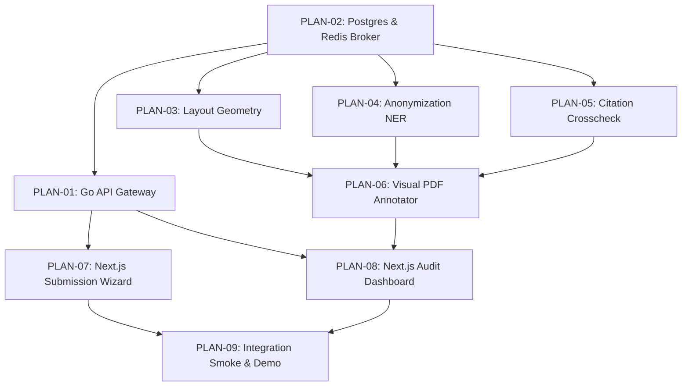

# Master Index: Sprint 1 Plan Files (Thursday MVC)
## Journal Management System (JMS) with AI Pre-Submission Engine

**Architecture:** Decoupled Hexagonal / Clean Architecture  
**Target Release:** Thursday, 2026-11-05 at 17:00 WIB  
**Repository Path:** `/Users/mac/Documents/Repositories/jms-uts/plans/`  

---

## 1. Plan Files Directory (1 Plan 1 File)

| Plan ID | File Name | Epic / Domain Focus | Story Points | Status |
|---|---|---|:---:|:---:|
| **PLAN-00** | [`00-INDEX.md`](./00-INDEX.md) | Master Plan Directory & Execution Dependency Matrix | — | Active |
| **PLAN-01** | [`PLAN-01-ingestion-control-plane.md`](./PLAN-01-ingestion-control-plane.md) | Ingestion & Control Plane (Go API Gateway + IAM + Presigned URLs) | 9 SP | Completed / Verified |
| **PLAN-02** | [`PLAN-02-data-plane-event-broker.md`](./PLAN-02-data-plane-event-broker.md) | Data Plane & Event Broker (PostgreSQL 16 + Redis `queue:ai_audit`) | 4 SP | Completed / Verified |
| **PLAN-03** | [`PLAN-03-layout-geometry-audit.md`](./PLAN-03-layout-geometry-audit.md) | AI Parsing: Layout & Margin Geometry ($1\text{ mm} \approx 2.83465\text{ pt}$) | 5 SP | Completed / Verified |
| **PLAN-04** | [`PLAN-04-double-blind-anonymization.md`](./PLAN-04-double-blind-anonymization.md) | AI Parsing: Double-Blind Anonymization (spaCy NER + Regex) | 5 SP | Completed / Verified |
| **PLAN-05** | [`PLAN-05-citation-graph-integrity.md`](./PLAN-05-citation-graph-integrity.md) | AI Parsing: Bidirectional Citation Graph Cross-Matching | 4 SP | Completed / Verified |
| **PLAN-06** | [`PLAN-06-visual-pdf-annotation.md`](./PLAN-06-visual-pdf-annotation.md) | Visual PDF Annotation Engine (Red Bounding Boxes + S3 Artifacts) | 4 SP | Completed / Verified |
| **PLAN-07** | [`PLAN-07-frontend-submission-wizard.md`](./PLAN-07-frontend-submission-wizard.md) | Frontend: 3-Step Author Submission Wizard & Direct S3 PUT | 5 SP | Completed / Verified |
| **PLAN-08** | [`PLAN-08-frontend-audit-dashboard.md`](./PLAN-08-frontend-audit-dashboard.md) | Frontend: Live Pre-Submission Audit Inspection Dashboard | 4 SP | Completed / Verified |
| **PLAN-09** | [`PLAN-09-quality-assurance-demo.md`](./PLAN-09-quality-assurance-demo.md) | QA Automation, Benchmark Papers & Thursday Demo Script | 2 SP | Active |

---

## 2. Dependency Flow Graph

