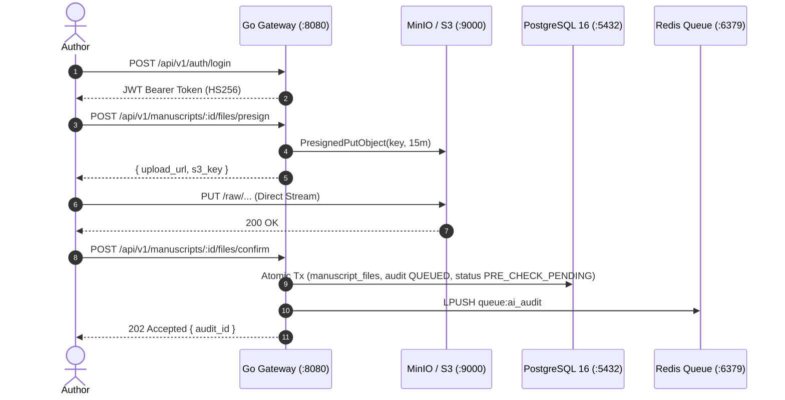

# PLAN-01: Ingestion & Control Plane (Go Gateway)

**Plan ID:** PLAN-01  
**Component:** `backend/gateway`  
**Target Release:** Thursday MVC (2026-11-05)  
**Assigned Persona:** Systems Architect (INTJ / ENTJ)  
**Story Points:** 9 SP (13 Hours)  
**Status:** Completed / Verified  

---

## 1. Plan Objective
Design and implement an ultra-low latency, non-buffering Go API Gateway handling user authentication, role-based access control (RBAC), and direct-to-S3 presigned upload generation without proxying large manuscript files through gateway memory.

---

## 2. Technical Deliverables & Architecture

---

## 3. Sub-Task Drilldown

* **TSK-101: IAM, JWT & RBAC Engine**
  - Path: `backend/gateway/internal/usecase/auth_usecase.go`
  - Implementation: bcrypt password hashing (cost 10), HMAC-SHA256 JWT claims (`user_id`, `email`, `role`, `exp`).
  - Middleware: `RequireRoles(roles ...domain.Role)` enforcing author/editor boundaries.

* **TSK-102: Direct-to-S3 Presigned URL Provider**
  - Path: `backend/gateway/internal/infrastructure/storage/minio_storage.go`
  - Implementation: MinIO Go SDK v7 client calling `PresignedPutObject` with 15-minute TTL.
  - S3 Key Partitioning: `raw/{manuscript_id}/{uuid}.{ext}`.

* **TSK-103: Transactional Metadata Submission Handler**
  - Path: `backend/gateway/internal/usecase/submission_usecase.go`
  - Implementation: GORM transactional block computing next manuscript file version, inserting `manuscript_files` record, inserting `pre_submission_audits` in state `QUEUED`, and transitioning manuscript to `PRE_CHECK_PENDING`.

* **TSK-104: Audit Outcome Query Endpoint**
  - Path: `backend/gateway/internal/delivery/http/handler/submission_handler.go`
  - Implementation: `GET /api/v1/audits/:id` fetching JSONB audit records, overall score, and S3 annotated key.

---

## 4. Definition of Done (DoD)
- [x] Zero payload buffering on Go gateway during 50MB PDF upload tests.
- [x] All endpoints output unified `{ "success": true, "data": ..., "error": null }` envelope.
- [x] Unit test `TestRequestUploadURL` passes in `submission_usecase_test.go`.
