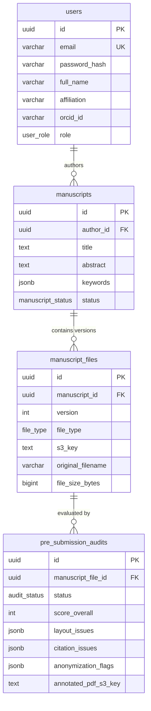

# PLAN-02: Data Plane & Event Broker (Postgres + Redis)

**Plan ID:** PLAN-02  
**Component:** `backend/db`, `backend/gateway/internal/infrastructure/redis`, `backend/ai-worker`  
**Target Release:** Thursday MVC (2026-11-05)  
**Assigned Persona:** Data Infrastructure Engineer (INTP / ISTJ)  
**Story Points:** 4 SP (8 Hours)  
**Status:** Completed / Verified  

---

## 1. Plan Objective
Design and deploy the production-grade PostgreSQL 16 relational data plane and high-throughput Redis event broker queue (`queue:ai_audit`) ensuring decoupled, asynchronous manuscript processing with zero data loss.

---

## 2. Technical Deliverables & Architecture



---

## 3. Sub-Task Drilldown

* **TSK-201: PostgreSQL 16 DDL & Migrations**
  - Path: `backend/db/migrations/000001_init_schema.up.sql`
  - Implementation: Custom PostgreSQL ENUMs (`user_role`, `manuscript_status`, `file_type`, `audit_status`), foreign key cascades, and JSONB document columns for audit outcomes.
  - Seeds: `backend/db/seeds/001_seed_dev_data.sql` with hashed test credentials (`author@jms.org`, `editor@jms.org`).

* **TSK-202: Redis Producer Choreography**
  - Path: `backend/gateway/internal/infrastructure/redis/event_publisher.go`
  - Implementation: `LPUSH queue:ai_audit` with serialized payload:
    ```json
    { "audit_id": "UUID", "file_id": "UUID", "manuscript_id": "UUID", "s3_key": "raw/...", "file_type": "PDF" }
    ```

* **TSK-203: Redis Worker Consumer & Connection Recovery**
  - Path: `backend/ai-worker/app/worker.py`
  - Implementation: `BRPOP queue:ai_audit` with 2-second timeout, exponential reconnection backoff on network blips, and graceful shutdown handling.

---

## 4. Definition of Done (DoD)
- [x] PostgreSQL 16 container successfully initialises and runs migrations from `/docker-entrypoint-initdb.d`.
- [x] Redis responds with `PONG` and holds jobs across network reconnects.
- [x] End-to-end event dispatch and consumer acknowledgement confirmed under 1.0 second.

