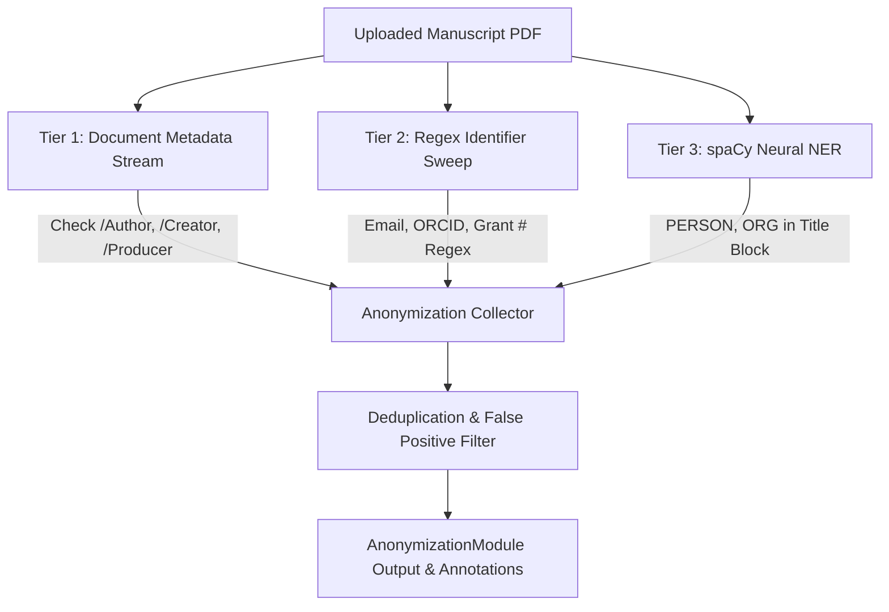

# PLAN-04: AI Double-Blind Anonymization Module

**Plan ID:** PLAN-04  
**Component:** `backend/ai-worker/app/modules/anonymization.py`  
**Target Release:** Thursday MVC (2026-11-05)  
**Assigned Persona:** NLP & AI Safety Specialist (INFJ / INTP)  
**Story Points:** 5 SP (8 Hours)  
**Status:** Completed / Verified  

---

## 1. Plan Objective
Implement a multi-tier anonymization auditing engine using `spaCy` Named Entity Recognition (NER) combined with deterministic regex heuristics to detect leaked author identities, affiliations, email addresses, ORCIDs, and grant numbers in double-blind peer review manuscripts.

---

## 2. Technical Architecture & Multi-Tier Verification

---

## 3. Sub-Task Drilldown

* **TSK-302.1: PDF Low-Level Metadata Inspection**
  - Read `doc.metadata` stream (`/Author`, `/Creator`, `/Producer`, `/CreationDate`).
  - Flag non-generic metadata entries (excluding "admin", "user", "unknown").

* **TSK-302.2: Deterministic Regex Identifiers**
  - Email Pattern: `\b[A-Za-z0-9._%+-]+@[A-Za-z0-9.-]+\.[A-Z|a-z]{2,}\b`
  - ORCID Pattern: `\b\d{4}-\d{4}-\d{4}-\d{3}[\dX]\b`
  - Grant Disclosures: `(?i)\b(?:grant|supported\s+by|funded\s+by|award\s+number)\s*[:#]?\s*([A-Z0-9\-]+)`

* **TSK-302.3: spaCy Title-Block Named Entity Extraction**
  - Load `en_core_web_sm` as a singleton.
  - Slice title block (first 1500 characters of Page 1).
  - Extract entities with labels `PERSON` and `ORG`.
  - Apply academic filter set to suppress common false positives (`"abstract"`, `"university"`, `"department"`, `"ieee"`, `"elsevier"`).

---

## 4. Definition of Done (DoD)
- [x] Correctly detects test email address (`author@mit.edu`) and ORCID identifier (`0000-0002-1825-0097`).
- [x] Zero crashes when encountering PDFs with empty or missing metadata streams.
- [x] Unit test `tests/test_anonymization.py` passes all test cases with 100% success rate.
