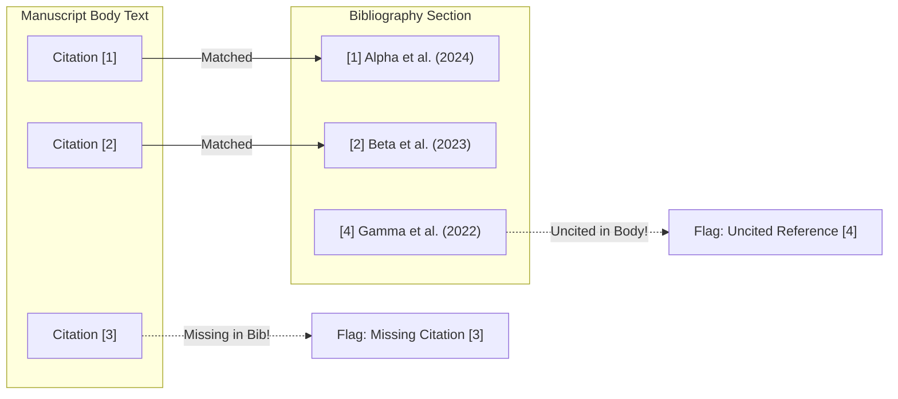

# PLAN-05: AI Citation Graph Integrity Module

**Plan ID:** PLAN-05  
**Component:** `backend/ai-worker/app/modules/citation.py`  
**Target Release:** Thursday MVC (2026-11-05)  
**Assigned Persona:** Graph Theory & Parsing Specialist (INTP / ISTJ)  
**Story Points:** 4 SP (6 Hours)  
**Status:** Completed / Verified  

---

## 1. Plan Objective
Design and implement a bidirectional graph validation algorithm that splits manuscripts into Body and Bibliography sections, parses inline citations (`[1]`, `[1-3]`, `Author (Year)`), and verifies that:
1. Every cited work exists in the bibliography ($\text{Out-degree} \ge 1$).
2. Every bibliography entry is cited at least once in the body text ($\text{In-degree} \ge 1$).

---

## 2. Graph Formulation & Cross-Matching Rules

Let $C_{inline} = \{ c_1, c_2, \dots, c_n \}$ be the set of inline citation keys parsed from the manuscript body.  
Let $B = \{ b_1, b_2, \dots, b_m \}$ be the set of parsed bibliography item keys.

$$\text{Missing Citations} = C_{inline} \setminus B$$
$$\text{Uncited References} = B \setminus C_{inline}$$

A manuscript **passes** citation integrity if and only if:
$$\text{Missing Citations} = \emptyset \quad \land \quad \text{Uncited References} = \emptyset$$

---

## 3. Sub-Task Drilldown

* **TSK-303.1: Section Boundary Decomposition**
  - Header Regex: `(?i)\n\s*(?:references|daftar\s+pustaka|bibliography|literature\s+cited)\s*\n`
  - Split document into `body_text` and `bib_text`.

* **TSK-303.2: Numeric Citation Range Expansion**
  - Regex: `\[(\d+(?:\s*,\s*\d+)*|\d+\s*-\s*\d+)\]`
  - Automatically expand hyphenated ranges: `[1-4]` $\rightarrow \{1, 2, 3, 4\}$.
  - Expand comma-separated lists: `[1, 3, 7]` $\rightarrow \{1, 3, 7\}$.

* **TSK-303.3: Bibliography Entry Extraction & Discrepancy Reporting**
  - Parse indices: `\[(\d+)\]\s*([^\[\n]+)`.
  - Compute set differences and format discrepancy lists.

---

## 4. Definition of Done (DoD)
- [x] Correctly expands hyphenated ranges (`[2-5]`) into individual integers.
- [x] Flags missing citations and uncited references with informative truncated descriptions.
- [x] `tests/test_citation.py` passes all positive and negative assertion fixtures.

