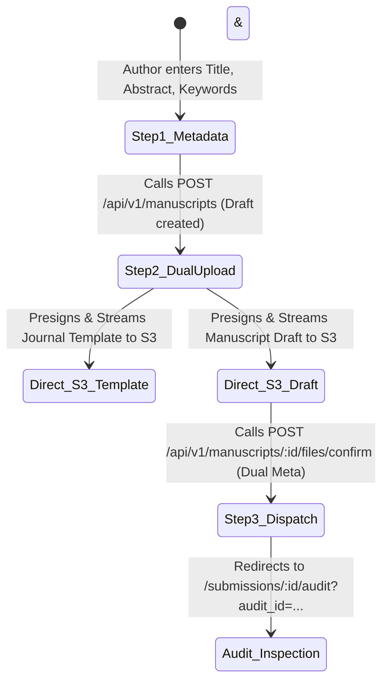

# PLAN-07: Frontend 3-Step Submission Wizard

**Plan ID:** PLAN-07  
**Component:** `frontend/src/app/submissions/new`  
**Target Release:** Thursday MVC (2026-11-05)  
**Assigned Persona:** Frontend Ergonomist & UI Architect (ENFP / ISFJ)  
**Story Points:** 5 SP (7 Hours)  
**Status:** Completed / Verified  

---

## 1. Plan Objective
Design and implement an intuitive 3-step submission wizard in Next.js 15 App Router that guides authors through metadata input, dual direct-to-S3 drag-and-drop file upload (Journal Reference Template + Author Manuscript Draft), and automated comparative pre-check audit dispatching with real-time feedback.

---

## 2. User Journey Flow

---

## 3. Sub-Task Drilldown

* **TSK-401.1: Step 1 Metadata Form**
  - Path: `frontend/src/app/submissions/new/page.tsx`
  - Inputs: Manuscript Title, Abstract (multi-line textarea), comma-separated Keywords.
  - Client-side validation: Ensures minimum length requirements before enabling transition.

* **TSK-401.2: Step 2 Dual-Dropzone S3 Direct Upload (Side-by-Side Responsive Layout)**
  - Two-Column Grid: `grid grid-cols-1 md:grid-cols-2 gap-6 items-stretch` replacing vertical stacking ("downside").
  - Dropzone A (Left): Journal Reference Template (`.pdf`) — defines target geometry, column layout, and margins with optional fallback indicator.
  - Dropzone B (Right): Author Manuscript Draft (`.pdf`) — the mandatory submission to be audited.
  - Integrated Drag-and-Drop: HTML5 `onDragOver` and `onDrop` events on both dropzone labels for instant file attachment.
  - Presigns both files individually via `requestUploadPresign(manuscriptId, filename, "PDF", role)`.
  - Executes raw direct-to-S3 binary streams via `uploadDirectToS3(uploadUrl, file)`.

* **TSK-401.3: Step 3 Confirmation & Automated Routing**
  - Invokes `confirmSubmission(manuscriptId, { draft_file, template_file })` to update gateway and trigger Redis worker.
  - Displays progress spinner and transitions seamlessly to `/submissions/[id]/audit`.

---

## 4. Definition of Done (DoD)
- [x] Zero payload bytes proxied through the Next.js server runtime (direct browser-to-S3 upload).
- [x] Dual-dropzone UI cleanly accommodates both Template and Draft uploads.
- [x] Responsive layout with graceful error toasts for network drops or invalid file formats.
- [x] Next.js 15 static build (`tsc --noEmit` and `pnpm build`) succeeds without warnings.

