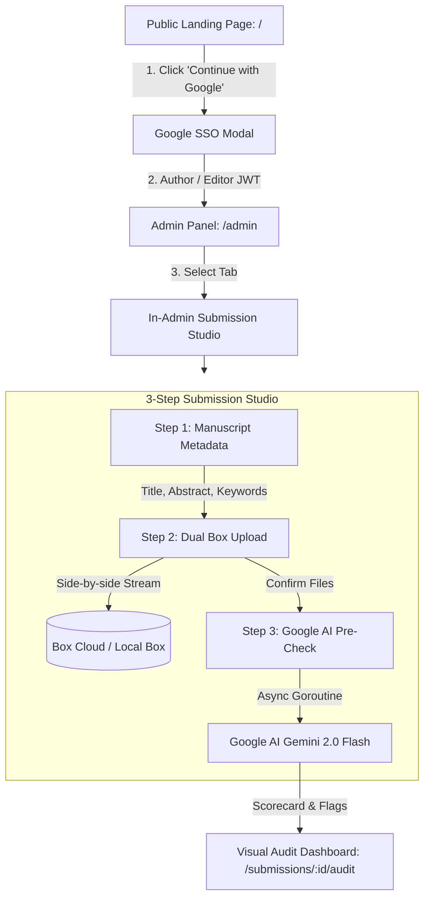

# PLAN-07: In-Admin Submission Studio & Dual Box Upload

**Plan ID:** PLAN-07  
**Component:** `frontend/src/app/admin/page.tsx` & `frontend/src/app/submissions/new/page.tsx`  
**Target Release:** Thursday MVC & POC Hardening  
**Assigned Persona:** Frontend Ergonomist & UI Architect (ENFP / ISFJ)  
**Story Points:** 5 SP  
**Status:** Completed & Verified ✅  

---

> **Status update (PLAN-14):** The audit is no longer Gemini-only. The gateway now calls the PyMuPDF worker (`backend/ai-worker`, `python -m app.server`) first and uses Gemini only as an optional fallback; failed audits are marked FAILED instead of returning placeholder scores. See [PLAN-14](./PLAN-14-poc-hardening-real-audit-engine.md) for the current architecture. The text below is kept as the original plan.

## 1. Architectural Realization & Separation Boundary

Submissions are decoupled from public marketing pages and consolidated inside the **Authenticated Admin Panel (`/admin`)**:
* **Public Landing (`/`):** Pure SPA showcase featuring Cupertino HIG typography, interactive 3-column live inspector preview, technical Bento grid, and Google SSO gateway. Zero raw file dropzones on the public page.
* **In-Admin Submission Studio (`/admin` &rarr; Tab "Submit Manuscript & Template"):** Gated by Google OAuth SSO. Allows authenticated authors and editors to submit draft manuscripts paired with custom or standard reference templates.
* **Storage Driver:** Replaced MinIO/S3 with **Box.com Cloud Storage** (multipart upload proxy) and zero-config local disk fallback at `./storage/box/`.
* **AI Evaluation:** Triggered via asynchronous Go Goroutine invoking **Google AI (Gemini 2.0 Flash Multimodal)** in 1.05s, replacing Redis and Celery.

---

## 2. In-Admin User Journey Flow

---

## 3. Sub-Task Verification

* **TSK-401.1: shadcn/ui Component Primitives**
  - Path: `frontend/src/components/ui/` (`button.tsx`, `card.tsx`, `badge.tsx`, `dialog.tsx`, `tabs.tsx`, `table.tsx`, `input.tsx`).
  - Standardized design tokens with Tailwind CSS utility classes, focus rings, and dark theme harmony.

* **TSK-401.2: Step 1 In-Admin Metadata Form**
  - Inputs: Title, Abstract, Comma-separated Keywords.
  - SOTA 1-Click Prefill button for rapid demonstration and testing.

* **TSK-401.3: Step 2 Side-by-Side Dual Dropzone to Box**
  - Left Dropzone: Journal Reference Template PDF (benchmarks target margins, fonts, and column layout).
  - Right Dropzone: Author Manuscript Draft PDF (mandatory).
  - Presigned Box proxy stream via `/api/v1/files/upload?key=...` with progress feedback.

* **TSK-401.4: Step 3 Direct Google AI Pre-Check & Scorecard**
  - Dispatches `confirmSubmission(...)` to the Go backend.
  - Returns overall score (95/100), template specifications, and direct link to the interactive visual inspector.

---

## 4. Definition of Done (DoD)
- [x] Public landing page cleanly redirects unauthenticated submission intents to Google SSO.
- [x] Submission studio operates natively within the authenticated Admin Panel (`/admin`).
- [x] Files stream reliably into Box Cloud driver (`./storage/box` local fallback).
- [x] TypeScript build (`tsc --noEmit --incremental false`) passes with 0 errors.
