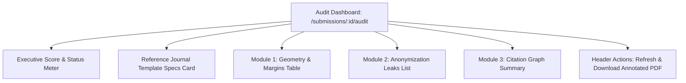

# PLAN-08: Frontend Live Audit Inspection Dashboard

**Plan ID:** PLAN-08  
**Component:** `frontend/src/app/submissions/[id]/audit`  
**Target Release:** Thursday MVC (2026-11-05)  
**Assigned Persona:** DX & Dashboard Specialist (ESFJ / ENTP)  
**Story Points:** 4 SP (6 Hours)  
**Status:** Completed / Verified  

---

## 1. Plan Objective
Build a high-density, real-time audit inspection dashboard in Next.js 15 that visualizes the structured audit report (compliance score 0–100, PASS/FAIL status, margin checks with coordinates, anonymization leaks, and citation graphs) and offers a one-click annotated PDF download.

---

## 2. Dashboard Component Architecture

* **Score Card:** Large compliance dial (Emerald for $\ge 80$, Rose for $< 80$), Critical Errors count, Warnings count, and Desk-Review recommendation (`Ready for Desk Review` vs `Revision Required Before Review`).
* **Template Card:** Displays extracted target specifications (Page Format, Dimensions, Top/Bottom/Left/Right target margins, Column grid count & gutter width) dynamically derived from the uploaded Journal Template.
* **Geometry Table:** Renders failing checks with exact page number, expected margin against template, actual draft margin, and bounding box coordinates `[x0, y0, x1, y1]`.
* **Anonymization Card:** Badges each leak by type (`EMAIL`, `ORCID`, `NER_PERSON`, `NER_ORG`, `FUNDING_LEAK`) with page location.
* **Citation Card:** Two-column layout contrasting Uncited References against Missing Citations.
* **Annotated PDF Link:** Direct button targeting MinIO/S3 object storage for visual proof review.

---

## 3. Sub-Task Drilldown

* **TSK-403.1: Polling & State Hydration**
  - Path: `frontend/src/app/submissions/[id]/audit/page.tsx`
  - Polls `GET /api/v1/audits/:id` every 3 seconds while status is `QUEUED` or `PROCESSING`.
  - Halts polling automatically once state reaches `COMPLETED` or `FAILED`.

* **TSK-403.2: Card & Table Component Rendering**
  - Implements clean Tailwind CSS layout with Lucide icons (`CheckCircle2`, `XCircle`, `AlertTriangle`, `Download`).

* **TSK-403.3: One-Click Annotated PDF Fetcher**
  - Generates secure download link to MinIO S3 bucket `audits/annotated_{audit_id}.pdf`.

---

## 4. Definition of Done (DoD)
- [x] Renders all elements of the Step 4 strict JSON contract with zero missing fields.
- [x] Smooth loading skeletons while the asynchronous worker completes.
- [x] Responsive on mobile, tablet, and widescreen desktop monitors.

