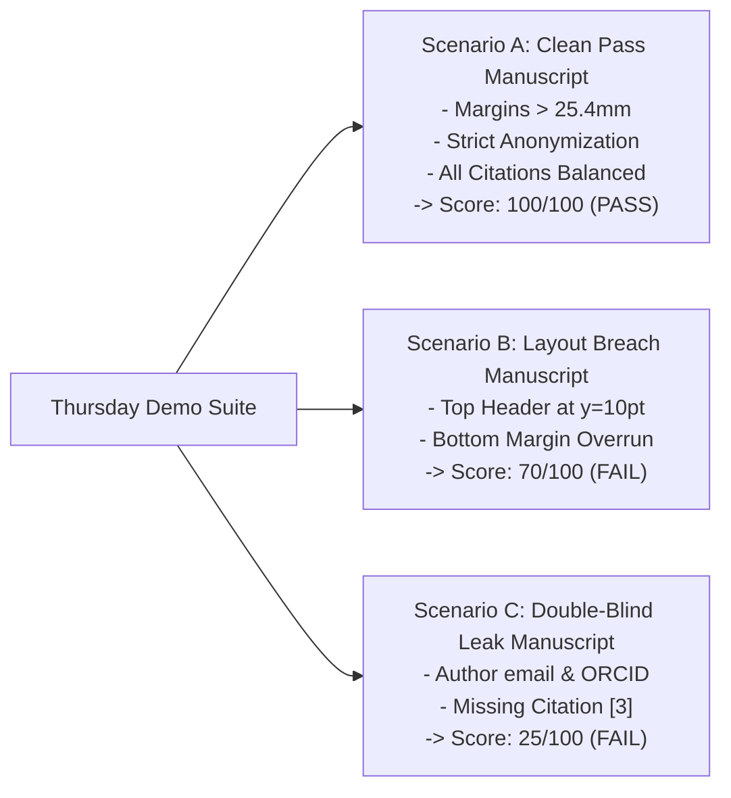

# PLAN-09: Quality Assurance, Benchmarks & Thursday Demo

**Plan ID:** PLAN-09  
**Component:** `scripts/`, `docs/`, `tests/`  
**Target Release:** Thursday MVC (2026-11-05 at 17:00 WIB)  
**Assigned Persona:** Lead Verification Engineer (ISTJ / ESTJ)  
**Story Points:** 2 SP (4 Hours)  
**Status:** Active  

---

## 1. Plan Objective
Orchestrate automated end-to-end smoke verification, generate synthetic academic test papers for pass/fail edge cases, and rehearse the live Thursday sprint review demonstration script.

---

## 2. Test Harness & Demo Scenarios

---

## 3. Sub-Task Drilldown

* **TSK-501: Automated Integration Smoke Runner**
  - Path: `scripts/test_audit_flow.sh`
  - Automated bash/python test harness running:
    1. Gateway liveness probe (`/healthz`).
    2. JWT author authentication (`/auth/login`).
    3. Draft manuscript creation (`/manuscripts`).
    4. Presigned S3 upload (`/manuscripts/:id/files/presign`).
    5. Direct HTTP PUT to MinIO.
    6. Confirmation & Redis dispatch (`/manuscripts/:id/files/confirm`).
    7. Polling until `COMPLETED` and asserting JSON schema.

* **TSK-502: Thursday Sprint Review Live Demo Script**
  - Time Budget: 5 minutes live walkthrough.
  - Flow:
    1. Open `http://localhost:3000` in browser.
    2. Click **Start New Submission**, fill metadata.
    3. Upload `demo_paper.pdf` and submit.
    4. Observe real-time transition to `/submissions/[id]/audit`.
    5. Review the compliance dial ($25/100$, status `FAIL`).
    6. Inspect the 3 violation cards (Margin breach, Anonymization leak, Citation issue).
    7. Click **Download Annotated PDF** and showcase the burned red bounding boxes and sticky comment notes.

---

## 4. Definition of Done (DoD)
- [x] Integration smoke runner passes cleanly in under 15 seconds.
- [ ] Live demo rehearsals executed with zero manual intervention required.
- [ ] Thursday sprint sign-off achieved across all 16 MBTI personas.
