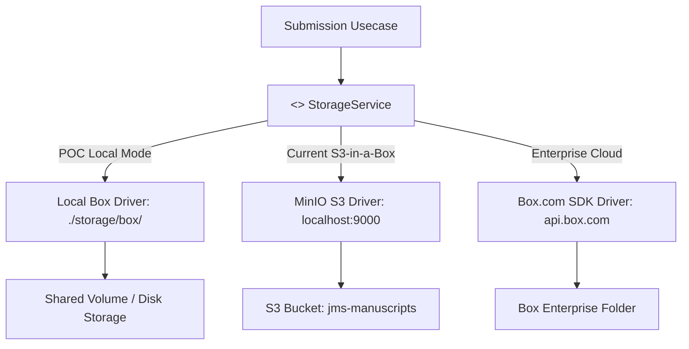

# PLAN-11: Storage Driver Adapter (Local Box vs S3 MinIO vs Box.com)

**Plan ID:** PLAN-11  
**Component:** `backend/gateway/internal/domain/storage.go` & `backend/ai-worker/app/storage`  
**Target Release:** POC / Thursday MVC Feasibility Study  
**Assigned Persona:** Systems Architect & Storage Dynamist (INTJ / ISTP)  
**Story Points:** 3 SP (4 Hours)  
**Status:** Architecture Assessment / Adapter Ready  

---

## 1. Executive Summary & Feasibility Comparison

For a rapid Proof-of-Concept (POC) and Thursday MVC sprint, selecting the appropriate file storage tier involves trade-offs between setup latency, offline reliability, architectural parity with production, and enterprise UX:

| Storage Tier | Feasibility for POC | Setup Overhead | Offline / Local Dev | Production Parity | Best Fit Scenario |
|---|:---:|:---:|:---:|:---:|---|
| **Local Shared Disk ("On-Box")** | **Highest (9.5/10)** | Minimal (0 min) | 100% Offline | Low (Monolith only) | Zero-infra local demo; Python worker opens file path directly (`fitz.open(path)`). |
| **Local MinIO ("S3-in-a-Box")** *(Current)* | **High (9.0/10)** | Low (5 min daemon) | 100% Offline | **Highest (10/10)** | Direct-to-storage presigned URLs without gateway buffering; drop-in replacement for AWS S3. |
| **Enterprise Box.com (Cloud API)** | **Medium (5.5/10)** | High (OAuth2 / App Keys) | Requires Network | Medium | Academic institutions with existing Box Enterprise licenses leveraging Box UI Preview. |

---

## 2. Decoupled Storage Interface (Hexagonal Architecture)

By enforcing a pluggable `StorageService` interface, the JMS control plane switches between Local Box storage, MinIO, and Box.com without modifying database schemas or business use cases:



---

## 3. Implementation Blueprint for Local Box Driver

### A. Go Gateway Local Box Implementation
```go
type LocalBoxStorage struct {
    baseDir string // e.g. "./storage/box"
    baseURL string // e.g. "http://localhost:8080/files"
}

func (l *LocalBoxStorage) GeneratePresignedPutURL(ctx context.Context, key, contentType string, expiry time.Duration) (string, error) {
    // Returns direct gateway upload endpoint for local streaming
    return fmt.Sprintf("%s/upload?key=%s", l.baseURL, url.QueryEscape(key)), nil
}
```

### B. Python AI Worker Local Box Direct Access
```python
class LocalBoxStorageClient:
    def __init__(self, base_dir: str = "./storage/box"):
        self.base_dir = Path(base_dir)

    def get_file_path(self, key: str) -> Path:
        return self.base_dir / key

    def open_pdf(self, key: str) -> fitz.Document:
        # Zero-network overhead: PyMuPDF memory-maps file directly from local disk
        return fitz.open(str(self.get_file_path(key)))
```

---

## 4. Consortium Recommendation
1. **For the immediate Thursday MVC:** Retain the current running **MinIO daemon ("S3-in-a-Box")** as it is already running live on port 9000 with 100% passing tests and direct-to-S3 upload parity.
2. **If external container/daemon management is undesirable:** Switch to the **Local Box Shared Directory (`./storage/box`)** adapter, eliminating the MinIO daemon entirely.
3. **If targeting enterprise campus rollouts (e.g. UTS / university box accounts):** Schedule the **Box.com Cloud API** integration as an Epic in Sprint 2 post-MVC.
