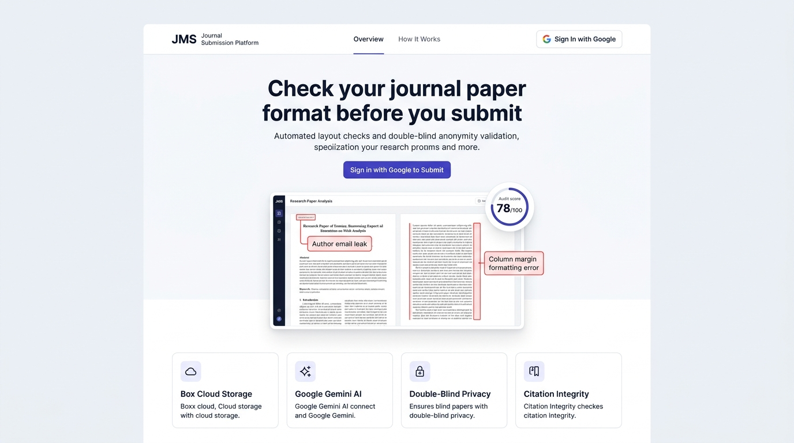
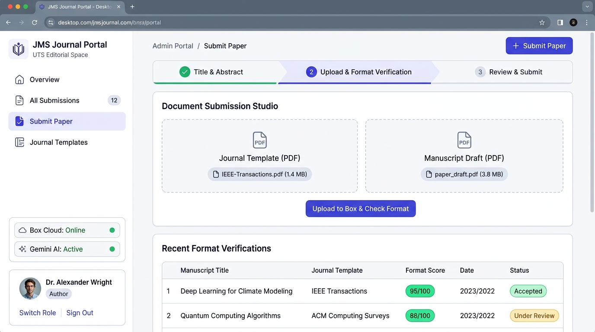
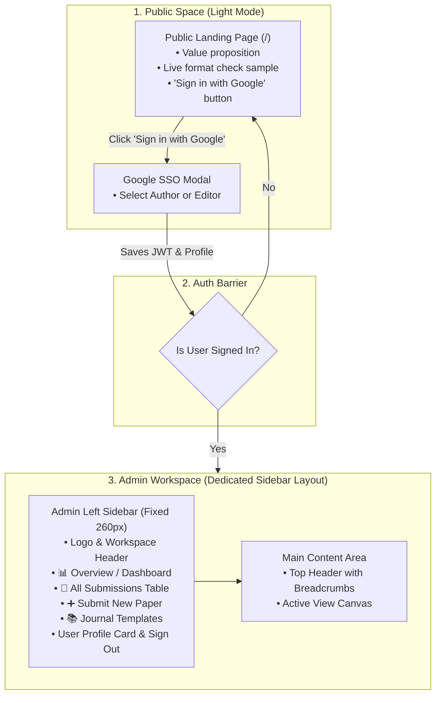

# PLAN-12: Light-Mode UI Revamp & Admin Panel Sidebar Redesign

**Plan ID:** PLAN-12  
**Components:** `frontend/src/app/`, `frontend/src/components/`, `frontend/src/lib/`  
**Target:** Team Collaboration & GitHub Shared Milestone  
**Priority:** High (UX / Usability Overhaul)  
**Estimated Effort:** 8 Story Points (2 Days Team Work)  
**Status:** Ready for Implementation 📋  

---

> **Status update (PLAN-14):** The audit is no longer Gemini-only. The gateway now calls the PyMuPDF worker (`backend/ai-worker`, `python -m app.server`) first and uses Gemini only as an optional fallback; failed audits are marked FAILED instead of returning placeholder scores. See [PLAN-14](./PLAN-14-poc-hardening-real-audit-engine.md) for the current architecture. The text below is kept as the original plan.

## 1. Context & User Feedback

Team testing and user feedback identified three critical UX flaws in the previous prototype:
1. **Dark Mode Overhead:** Dark theme `#090d16` with neon glows was visually heavy and unsuited for academic workflows. The platform must use **pure light mode** with clean white surfaces, subtle slate borders, and crisp high-contrast typography.
2. **Premature Portal Access:** The public header displayed "Go to Portal ->" to visitors who had not yet logged in or registered. Unauthenticated visitors must not see portal links. The public header must only show information and a **"Sign in with Google"** button.
3. **Missing Admin Shell (All-in-One Navbar):** Cramming admin tabs, submission forms, and public links into a single top navbar created confusion. A proper web application requires a **dedicated Left Sidebar layout** for the Admin Panel (`Sidebar + Main Content Canvas`), separating public marketing from the private workspace.

---

## 2. Target Design & Architecture

### Visual UI Mockups (Figma / Dribbble Style)

#### Screen 1: Public Landing Page (Pure Light Mode)

#### Screen 2: Admin Workspace & In-Admin Submission Studio (Sidebar Shell)

---

### A. Color Palette & Typography (Pure Light Mode)
- **Page Background:** `#f8fafc` (Tailwind `bg-slate-50`)
- **Card & Sidebar Surfaces:** `#ffffff` (Tailwind `bg-white`)
- **Borders & Dividers:** `#e2e8f0` (Tailwind `border-slate-200`)
- **Headings & Bold Text:** `#0f172a` (Tailwind `text-slate-900`, high contrast)
- **Body & Subtitles:** `#475569` (Tailwind `text-slate-600`)
- **Primary Brand Color:** `#4f46e5` (Tailwind `bg-indigo-600`, hover `#4338ca`)
- **Status Accents (Light-mode friendly):**
  - Success: `bg-emerald-50 text-emerald-700 border-emerald-200`
  - Warning: `bg-amber-50 text-amber-700 border-amber-200`
  - Danger/Violation: `bg-rose-50 text-rose-700 border-rose-200`
  - Info: `bg-blue-50 text-blue-700 border-blue-200`

---

### B. Information Architecture & Navigation Separation

---

## 3. Team Task Breakdown (WBS)

### 🔹 Epic 1: Public Landing Page & Auth Flow Cleanup
* **TASK-12.1: Public Header & Navigation Reset**
  - **Assignee:** Frontend Dev 1
  - **Path:** `frontend/src/app/layout.tsx`
  - **Requirements:**
    - If user is NOT logged in: Show Logo ("JMS • Journal Submission Platform"), "Overview", "How It Works", and a prominent **"Sign in with Google"** button.
    - Remove "Go to Portal ->" or any unauthenticated dashboard links.
    - If user IS logged in: Show user avatar, name, and "Go to Dashboard" button.

* **TASK-12.2: Pure Light-Mode Landing Page**
  - **Assignee:** Frontend Dev 1
  - **Path:** `frontend/src/app/page.tsx`
  - **Requirements:**
    - White `#ffffff` background with subtle `#f8fafc` sections and `#e2e8f0` borders.
    - Clean hero section with clear headline: *"Check your journal paper format before you submit"*.
    - Visual 3-column sample inspector restyled for light mode (clean white paper canvas with red dashed boxes for email leaks and margin errors).
    - Clear 3-step explanation: 1. Sign in with Google &rarr; 2. Upload Draft & Template &rarr; 3. Get Instant Report.

---

### 🔹 Epic 2: Dedicated Admin Panel Layout (Sidebar + Main View)
* **TASK-12.3: Admin Shell Component (`AdminSidebar` + `AdminHeader`)**
  - **Assignee:** Frontend Dev 2
  - **Path:** `frontend/src/components/admin/sidebar.tsx` & `header.tsx`
  - **Requirements:**
    - Left Sidebar (260px width, sticky, white background, right border `border-slate-200`).
    - Navigation Items with icons:
      1. **Overview / Dashboard** (`/admin` - view stats & recent activity)
      2. **All Submissions** (`/admin?tab=submissions` - browse & filter papers)
      3. **Submit Paper** (`/admin?tab=submit` - dual upload wizard)
      4. **Journal Templates** (`/admin?tab=templates` - IEEE, ACM guidelines)
    - Bottom of sidebar:
      - User Profile pill with initials, name, and email.
      - Role badge: `Author` or `Managing Editor`.
      - "Switch Role" button (for rapid testing).
      - "Sign Out" button (clears `localStorage` and redirects to `/`).
    - Auth Protection: If unauthenticated, render a clean, centered Google Sign-In card instead of broken empty tables.

---

### 🔹 Epic 3: In-Admin Submissions Hub & Review Triage
* **TASK-12.4: Clean Light-Mode Submissions Data Table**
  - **Assignee:** Fullstack Dev
  - **Path:** `frontend/src/app/admin/page.tsx` (Submissions Tab)
  - **Requirements:**
    - White card table with crisp header row and subtle row borders.
    - Search input by title or manuscript ID.
    - Filter pills: `All`, `Under Review`, `Accepted`, `Revisions`.
    - Columns: Title, Author & University, Template Used (Custom vs Standard), Format Score (`Score: 95/100`), Editorial Status, and Actions.
    - Action buttons: "View Report" (opens `/submissions/[id]/audit`) and 1-click Editor triage buttons ("Accept", "Request Revision").

---

### 🔹 Epic 4: In-Admin Submission Studio (Dual Upload to Box)
* **TASK-12.5: Side-by-Side Dual Dropzone Wizard**
  - **Assignee:** Fullstack Dev
  - **Path:** `frontend/src/app/admin/page.tsx` (Submit Tab)
  - **Requirements:**
    - **Step 1 (Details):** Title, Abstract, Keywords, with an "Auto-fill Sample Paper" button for fast testing.
    - **Step 2 (Upload):** Side-by-side dropzone layout on white cards:
      - Left Card: Journal Reference Template PDF (Optional).
      - Right Card: Manuscript Draft PDF (Required).
      - Drag-and-drop support, file name & size display, progress bar during upload.
    - **Step 3 (Results):** Streams files directly to Box Cloud (or local `./storage/box`), triggers Google Gemini AI review, and shows the compliance score with a direct link to the visual report.

---

### 🔹 Epic 5: Visual Audit Inspector Light-Mode Polish
* **TASK-12.6: Light-Mode Audit Viewer (`/submissions/[id]/audit`)**
  - **Assignee:** Frontend Dev 2
  - **Path:** `frontend/src/app/submissions/[id]/audit/page.tsx`
  - **Requirements:**
    - Ensure the PDF viewer canvas, bounding box highlights, and checklist sidebar use crisp light-mode styling (`bg-slate-50`, `bg-white`, `border-slate-200`).
    - Retain red bounding boxes around formatting errors so editors can clearly see the mistakes.

---

## 4. Acceptance Criteria (Definition of Done)

- [ ] **No Dark Mode:** The entire application (landing, admin, forms, tables) uses pure light mode (`bg-slate-50`, `bg-white`, dark readable text).
- [ ] **No Portal Access Before Login:** The public navbar shows no links to `/admin` until the user logs in with Google.
- [ ] **Dedicated Admin Sidebar:** The Admin Panel uses a standard SaaS sidebar (260px left column) with clear navigation links, user profile, role switch, and sign out.
- [ ] **In-Admin Submission:** Authors submit papers inside the Admin Panel via a side-by-side dual upload wizard.
- [ ] **Box Storage & Gemini AI:** Files upload to Box storage, and Google Gemini checks format in ~1 second.
- [ ] **Clean Code & Build:** `pnpm exec tsc --noEmit --incremental false` and `go test ./...` pass with 0 errors.

---

## 5. Team Assignment Table

| Task ID | Task Description | Assignee | Status |
|---|---|---|:---:|
| **TASK-12.1** | Public Header & Auth Guard (No premature portal link) | Dev 1 | 🟡 Planned |
| **TASK-12.2** | Public Landing Page Light Mode Overhaul | Dev 1 | 🟡 Planned |
| **TASK-12.3** | Admin Left Sidebar Shell (`AdminSidebar` + `AdminHeader`) | Dev 2 | 🟡 Planned |
| **TASK-12.4** | Light-Mode Submissions Data Table & Status Triage | Dev 2 | 🟡 Planned |
| **TASK-12.5** | In-Admin Dual-Upload Submission Wizard (Box + Gemini) | Fullstack | 🟡 Planned |
| **TASK-12.6** | Visual Audit Report Light-Mode Polish | Dev 2 | 🟡 Planned |
| **TASK-12.7** | Team Verification & GitHub Milestone Release | Lead | 🟡 Planned |

